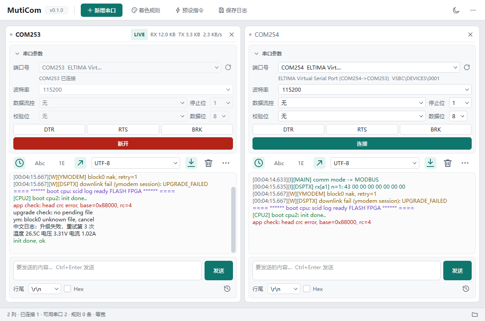
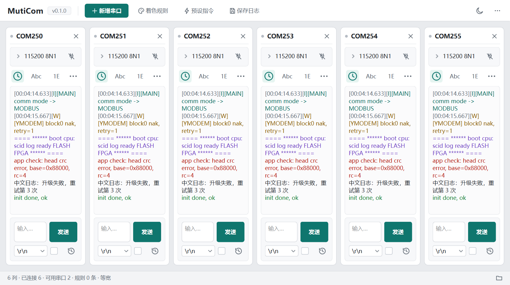

# MutiCom · 多路串口日志监视器

一个窗口里并排放多路串口日志，替代「开多个 VOFA+ 免费版窗口」。
纯日志监视（文本 / Hex），不做波形绘图、不做协议解析。



- **串口参数可折叠**：点「串口参数」那一条就收起，折叠后只剩一行摘要（端口/波特率/已连接）右边直接带连接按钮，省下 200px 高度全给日志；每列的折叠状态会记住
- **列宽等宽自适应**：不管开多少列都一次显示全，窗口够宽就平分，窄到 168px/列 以下才横向滚动
- **浅色主题**（默认）+ 深色一键切换，顶栏 ☾/☀ 按钮，重启记得上次的选择
- **全 SVG 矢量图标**，随主题自动换色，不会模糊
- 列窄或窗口矮时，串口参数面板自动收成一行摘要（点开才是完整表单），把高度让给日志
- 每列独立：串口参数 / 日志显示 / 发送区 / 着色、编码、字号、时间戳
- 日志按级别自动着色，还可自定义「关键词或正则 → 颜色」
- 发送支持行尾选择、Hex、上下键翻历史、一键预设指令
- 配置自动保存，下次打开列数、列宽、主题、端口、规则全都还在

1095×613 的窗口塞 6 路串口，一屏全显示、零横向滚动（每列 172px）：



## 快速开始

双击 **`run.bat`** 即可（它用 `C:\Python314\pythonw.exe` 启动，无控制台窗口）。

出问题时用 **`run_debug.bat`**，它会保留控制台把 traceback 打出来。

依赖（本机已装好，换机器才需要）：

```
PySide6==6.11.2
pyserial==3.5
```

> 注意：PATH 里的 `python` 可能是别的版本、没装 PySide6。`run.bat` 里写死了
> `C:\Python314\python.exe`，换机器时改那一行就行。

## 界面怎么用

| 位置 | 说明 |
| --- | --- |
| 列头 | 状态圆点（绿=已连接）、`端口名`、`LIVE` 标记、`RX / TX / 实时速率`（宽列全显示、中等列只显示 RX + 速率、窄列只留速率）、`✕` 关闭该列 |
| 串口参数 | 点标题那条可**折叠/展开**；展开后是端口下拉（带描述和 VID:PID，3 秒刷新热插拔）、波特率（可手输）、数据流控、停止位、校验位、数据位、`DTR/RTS/BRK`、连接/断开。**窄列或矮窗口会自动收起**（点过之后以你的选择为准） |
| 日志工具条 | `🕐` 时间戳、`Abc`/`1E` 文本/十六进制**互斥切换**（和 VOFA+ 一致）、`↗` 发送回显、编码下拉（吃掉剩余宽度，UTF-8/GBK/Latin-1）、`↓` 自动跟随、`🗑` 清屏、`⋯` 更多（字号 9~20、行数上限、忽略孤立 `\r`、保存日志、复制全部）。列窄时按钮会自动折叠进 `⋯` |
| 日志区 | 只读，等宽字体，行数上限默认 5 万行，超出自动裁掉最老的 |
| 发送区 | 多行输入、`发送`、行尾（`\r\n`/`\n`/`\r`/无）、`Hex` 发送、`历史`、预设指令按钮条 |

快捷键：

- `Ctrl+N` 新增一路串口
- `Ctrl+T` 打开着色规则
- `Ctrl+Enter` 发送输入框内容
- `↑ / ↓` 在输入框里翻历史（内容多行时用 `Ctrl+↑/↓`）

小细节：

- **列间分隔条双击**可以恢复等宽（拖过之后想还原就双击它）。
- **窄列会自动把参数面板收起来**，点那条摘要就展开；摘要右边的插头图标可以直接连/断，不用展开。
- 已连接但还没收到数据时，日志区显示「等待数据…」而不是「未连接」。
- **连接后参数控件会锁住**，要改先断开。
- **手动往上翻日志会自动关掉「滚屏」**，免得看历史时被拽回底部；点一下 `滚屏` 恢复。
- **两列不能连同一个 COM**，下拉里会标「已被第 N 列占用」并置灰。
- **端口被别的程序占着**（比如 VOFA+ 还开着）时，列内会红字提示「端口被占用」。
- DTR/RTS 是**开关**（勾上=有效），不是脉冲；`Break` 是发 100ms 的 Break 信号。
  有些 CH340/ESP 板子 DTR 一拉就复位，点之前想清楚。

## 着色规则

内置规则不用配，开箱即用（从上到下匹配，命中即停）：

| 规则 | 颜色 |
| --- | --- |
| `[E]` `[F]` | 红 `#f14c4c` |
| `[W]` | 琥珀 `#d7ba7d` |
| `[I]` | 青绿 `#4ec9b0` |
| `[D]` `[V]` | 暗灰 `#8b8b8b` |
| `error/err/fail/panic/fatal/abort` | 红 `#f14c4c` |
| `warn/retry/deprecated/timeout` | 琥珀 `#d7ba7d` |
| `ok/success/done/passed/ready` | 绿 `#2ea043` |
| `====` / `----` 分隔行 | 淡紫 `#c8b6ff` |

`Ctrl+T` 打开对话框可以加自己的规则：填匹配内容、选颜色、勾不勾「正则」都行。
**自定义规则优先于内置规则**，列表从上往下匹配，能用「上移/下移」调优先级。
正则写错了会标红提示，运行时自动降级成子串匹配，不会崩。保存后所有列立即重新着色
（按最近 256KB 原始数据重绘）。

## 预设指令

发送区上方的按钮就是预设，点一下直接发。`预设 ▾` 里能看到全部分组（按「分组」列归类），
点「管理预设…」可以增删改，支持 Hex 内容和单独的行尾设置。预设是全局一份，所有列共用。

## 配置文件在哪

`%LOCALAPPDATA%\dx1\MutiCom\config.json`

存了窗口大小、列宽、每列串口参数、显示选项、自定义规则、预设指令。
改动后 0.8 秒自动落盘，关窗口时强制存一次。顶栏 `⋯` 里可以导出/导入配置（换机器时很方便）。
配置写坏了程序也能起，坏文件会被改名成 `.bak`。

## 没有硬件时怎么自测

本机有 ELTIMA 虚拟串口对 **COM253 ↔ COM254**（往一个写，另一个能收到）。

```bash
# 1) 程序里连 COM254
# 2) 另开一个终端，往 COM253 灌混合日志（带中文、超长行、各种级别）
C:\Python314\python.exe tools\fake_log_feeder.py --port COM253 --rate 200 --duration 20

# 其他模式
... --mode raw --rate 100        # 纯二进制，适合看 Hex 视图
... --mode progress              # 只用 \r 刷新的进度条，验证「忽略孤立 \r」
... --burst 1048576              # 一次性 1MB 突发
... --rate 0                     # 不限速，压测
```

一键端到端自测（会自己起 feeder、验证收数据/跨列发送/Hex 视图/线程退出）：

```bash
C:\Python314\python.exe tools\selftest_serial.py
```

界面流程自测（不需要串口，验证新增列 / 端口列表下发 / 删列 / 配置回填）：

```bash
C:\Python314\python.exe tools\selftest_ui.py
```

改过 UI 想快速看一眼截图：

```bash
C:\Python314\python.exe tools\smoke_shot.py build\shot.png 3
```

## 代码结构

```
muticom/
├─ __main__.py        入口：QApplication + 主题 + 异常兜底
├─ main_window.py     顶栏 / 多列区域 / 状态条 / 配置存取
├─ column_area.py     横向列区（等宽自适应 + 横向滚动 + 列宽记忆）
├─ theme.py           主题令牌（浅/深两套）+ QSS 渲染 + 调色板
├─ icons.py           SVG 图标染色与缓存
├─ paths.py           资源路径（开发态 / 打包态）
├─ icons/*.svg        21 个单色矢量图标
├─ session_column.py  单列拼装：列头 + 参数 + 工具栏 + 日志 + 发送
├─ port_panel.py      串口参数面板
├─ log_view.py        日志视图（批量 HTML 插入）+ 工具条
├─ send_panel.py      发送区（历史 / Hex / 预设）
├─ serial_session.py  串口会话：每列一个线程 + 2ms 泵 + 批量投递
├─ decoder.py         增量解码 / 分行 / hexdump 格式化
├─ colorizer.py       着色规则引擎
├─ app_config.py      配置数据类 + JSON 持久化
├─ port_scanner.py    串口枚举与热插拔
├─ dialogs.py         着色规则 / 预设指令对话框
├─ ui_kit.py          深色下拉框、状态点、调色板、图标
└─ theme.qss.tmpl     主题模板（颜色全是占位符，改色去 theme.py）
tools/                灌数据脚本、串口/界面自测脚本、截图脚本
ref/                  VOFA+ 参考截图
```

性能实测（本机，PySide6 6.11.2 / Python 3.14）：

- 1500 行/秒（≈58 KB/s）连续灌 3 秒：渲染 4501 行，**丢弃 0**
- 4500 行/秒（≈228 KB/s）连续灌 3 秒：渲染 13501 行，**丢弃 0**
- 2.5 MB/s 极端灌流：界面仍可操作，超出渲染能力时按策略丢弃并在列头红字提示「丢弃 N 行」

## 常见问题

**双击 run.bat 没反应** —— 用 `run_debug.bat` 看报错；多半是解释器路径不对，或者没装 PySide6。

**中文乱码** —— 日志工具条里换编码（UTF-8 / GBK / Latin-1）。切换会按最近 256KB 重绘。

**日志刷太快、界面掉帧** —— `…` 里把行数上限调小（比如 10k），或者关掉时间戳。

**想打包成 exe** ——

```bash
C:\Python314\python.exe -m PyInstaller --noconfirm --clean --name MutiCom --windowed --onedir ^
  --add-data "muticom\theme.qss;muticom" ^
  --exclude-module PySide6.QtWebEngineCore --exclude-module PySide6.QtWebEngineWidgets ^
  --exclude-module PySide6.QtQuick --exclude-module PySide6.Qt3DCore ^
  --exclude-module tkinter --exclude-module numpy --exclude-module matplotlib ^
  muticom\__main__.py
```

PyInstaller 对 Python 3.14 的支持要 6.16+，本机是 6.22.3。打包后配置仍写
`%LOCALAPPDATA%`，不受安装目录只读影响。
